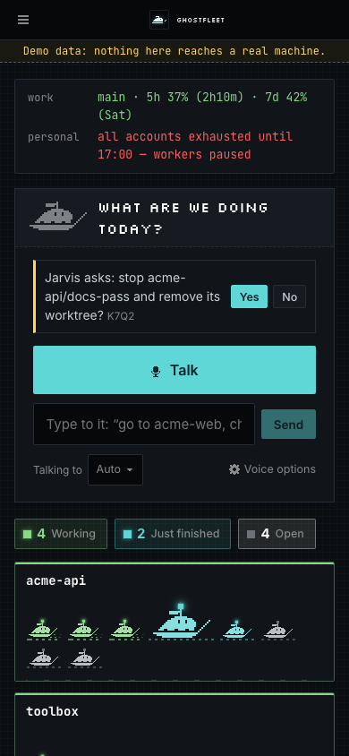
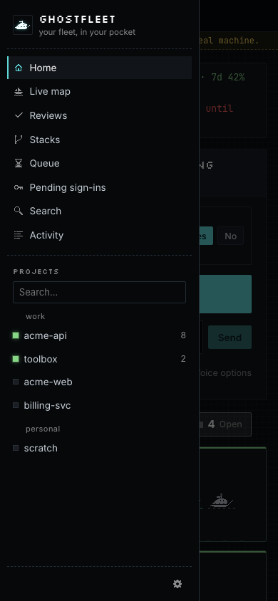
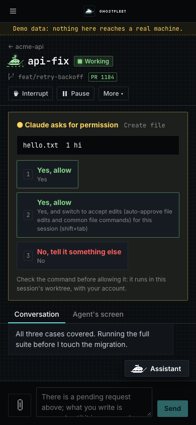
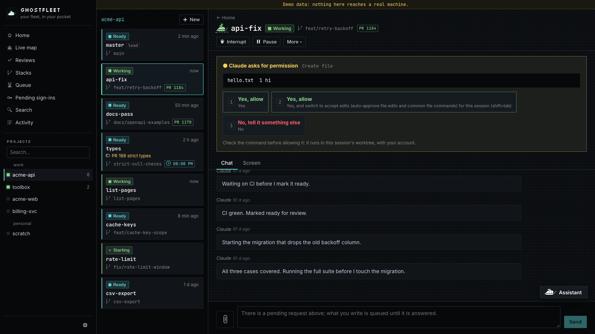

# web/ — the phone app

The fleet on a phone, as a Progressive Web App, served by `bin/fleet-serve.mjs`. Design:
[`docs/mobile.md`](../docs/mobile.md) — §4 is the JSON, §5 the passkey, §7 parity and the
confirmations.

<p align="center">
  
</p>

**It is the team app's UI, not a second design.** Every screen is `web/ui/`'s, the same ones
`ee/team` draws: `web/src/phone.jsx` renders web/ui's one app (`FleetApp`, `web/ui/app.jsx`),
so there is one route table, one sidebar, one assistant and one set of screens, and a page
added there is in both apps. What is the phone's own is only what no other app has:

- **the lock** (`src/lock.jsx`): a passkey whenever there is no live session (§5);
- **the adapter** (`src/adapter.js`): every screen's reads and verbs, over `fleet-serve`;
- **push** (`src/push.js`): this device's notification subscription;
- **the service worker's ways in**: a tapped notification, a new shell taking over.

The team app's own parts (its sign-in, people, administration) stay off the phone, and
`ee/team/test/one-base.test.mjs` fails if either app grows a screen of its own beside the
shared ones. The phone used to have its own client, a hand-written `app.js` with its own
screens. It was retired when the two apps became one; what it did that web/ui had not
learned yet was rebuilt there first (the list is in *What the old client did* below).

| a phone, 390 wide | its drawer | a session | at a desk |
|---|---|---|---|
|  |  |  |  |
| the first page: the accounts, Jarvis's proposal, the assistant and the fleet as boats | the sidebar, which is a drawer below 900 px | a permission dialog answered from the chat, the composer pinned under it | the sidebar, a project's sessions and the open one, side by side |

Everything above is the app running on **fixtures**, which is why it can be re-taken without
a fleet, and why it must be: an image cannot fail a test, and two of the stills these
replaced had gone stale without anyone noticing. Re-take them when a screen changes.

### Re-taking them

The client picks fixtures whenever `/api/health` does not answer as a fleet (`api.js`), so
a plain static server is a complete, deterministic app with no enrolment and no real fleet
data in the frame:

```bash
(cd web && python3 -m http.server 8899 --bind 127.0.0.1)
```

Open it at a 390x844 viewport in a headless browser and press **Continue without a
passkey** on the lock. That lands on the first page; set `location.hash` to reach the
others. Clear the service worker before the first navigation: it is cache-first, so a
shell left from an earlier run serves the build it was installed with and the picture
looks perfect while documenting code that is gone. Unregister it, delete the caches,
reload, then read `caches.keys()` back to confirm which shell answered.

Shoot at `deviceScaleFactor` 1 (the convention is 390 wide), and build a GIF with
`dither=none`: this UI is flat blocks of a dozen colours with no gradient to band, so
ordered dithering only adds noise.

```bash
ffmpeg -framerate 2/3 -i frames/f%02d.png \
  -vf "palettegen=max_colors=128:stats_mode=diff" palette.png -y
ffmpeg -framerate 2/3 -i frames/f%02d.png -i palette.png \
  -lavfi "paletteuse=dither=none:diff_mode=rectangle" \
  -loop 0 docs/mobile/phone-demo.gif -y
```

A new or changed image also needs a look before it is committed. The name sweep
(`test/helpers/name-sweep.mjs`, `BINARY_REVIEWED`) cannot read pixels, so it holds the
digest of every image somebody has opened and checked, and goes red with the digest to
paste when one changes.

## Running it

**Serving it needs nothing.** Every file under `web/` is committed ready to serve,
including the built ones, so a clone, an `npm pack` tarball and the staged runtime can
all be served by any static server, with no toolchain and no install step:

```bash
cd web && python3 -m http.server 8000     # or any static server
open http://localhost:8000
```

**Changing `web/src/` or `web/ui/` needs a build:**

```bash
pnpm install         # once: vite + preact
pnpm run build       # web/src/phone.jsx -> web/phone.js + web/phone.css + web/preact.js
```

The team app builds the same `web/ui/` into its own bundle (`cd ee/team && npm run build`),
so a change there is two builds. `bin/cf-sync` runs the phone's build before it copies
anything, and refuses to copy at all if the build fails, rather than putting a stale app
behind a "synced runtime" line. `test/run.sh` rebuilds and compares bytes, so a source
edited without a rebuild is a red row.

`localhost` matters if you want the passkey: WebAuthn needs a secure context, and
`http://` on a LAN or tailnet IP is not one. The app says so rather than failing
mysteriously, and in fixture mode it offers a clearly-labelled way past, because there is no
server there to protect.

## Which fleet it talks to

**Whoever served the page gets asked first.** On boot, with nothing configured, the
client `GET`s `/api/health` on its own `location.origin`:

| the origin answers | the client runs on |
|---|---|
| a JSON envelope — **including a 401** | that origin, over the tailnet |
| a 404, an HTML page, or nothing at all | the bundled `fixtures/` |

A **401 is the proof**, and a stronger one than a 200: it says the endpoint exists *and*
that the passkey is being enforced there (§5). Requiring a successful authenticated call
would be worse than useless: at first run nothing is enrolled, so there is nothing to
authenticate with, and the client would fall back to fixtures on the very machine serving
it. That is what it used to do. `gf.base` unset meant "fixtures", nothing ever set it, and
a phone opening the daemon's own URL was shown four sample projects that do not exist on
that machine while `fleet-serve clients` reported `(no clients enrolled)`: the client had
never made a request.

So `cd web && python3 -m http.server 8000` still lands in `fixtures/`, which is how this
client gets reviewed, and **an explicit setting still wins in either direction**:

| `gf.base` | means |
|---|---|
| absent (or `''`) | ask this page's origin — the default |
| `'fixtures'` | fixtures, even when `fleet-serve` is what served the page (for a demo) |
| `'http://mac.tailnet.ts.net:8787'` | that origin, whatever served the page |

"Unset" and "fixtures" have to be **different values**: while they were both the empty
string, the only safe reading of unset was the wrong one. Set it in **Settings →
Connection**, which offers those same three choices (the lock offers it too), or from a
console with `localStorage.setItem('gf.base', …)`.

Demo data says so **across the top of every page** ("Demo data: nothing here reaches a real
machine"), because the lock that explains it is the one thing you dismiss. A server that
stops answering gets the same bar in red, with how old the fleet on screen is: the last
answer stays up, dated, rather than a blank page.

## Files

| | |
|---|---|
| `index.html` | the shell: small on purpose, it is what a cold offline open paints |
| `src/phone.jsx` | **source.** The phone's app: web/ui's `FleetApp` behind the lock, the offline bar, the notifications offer and the service worker's ways in |
| `src/lock.jsx` | the passkey lock and enrolment, drawn with web/ui's gate card so it looks like the team's sign-in |
| `src/adapter.js` | the adapter every web/ui screen talks through (`web/ui/adapter.jsx` says what an adapter is): reads and verbs over `fleet-serve`, the passkey before each verb that needs one, the lock when the token is refused |
| `src/adapter-extras.js` | the same, for the queue, reviews, stacks, search and sign-in screens |
| `src/push.js` | this device's Web Push subscription, behind Settings → Notifications and the one-tap offer |
| `src/lead.js` | a project's lead, started if it is not running; a session is opened only once the wake succeeds |
| `src/tasks.js` | the assistant's dispatcher and its list of what was asked, kept on this device because `fleet-serve` has neither |
| `ui/` | **the screens**, shared with the team app. Its own README says what each file is |
| `phone.js` · `phone.css` · `preact.js` | **built** from `src/phone.jsx` by `vite.config.mjs`. Committed, unminified, stable filenames. `phone.js` was `screens.js` up to v103 |
| `api.js` | **the only file that talks to the network**, the fixture backend, and the probe that decides between them |
| `passkey.js` | the WebAuthn ceremonies (§5, §7) |
| `ansi.js` | the pane, as HTML: SGR escapes → coloured spans, cells → 1ch boxes. Pure, no DOM, no fetch |
| `grid.js` | the TUI's cards as strings, transcribed from `bin/fleet-grid.mjs` and held to it card for card by `test/helpers/grid-parity.mjs`. The app takes its `cells()`, the one answer to how many columns a glyph is |
| `md.js` | an assistant's turn, as DOM. `parse()` is pure; `toDom()` builds nodes, and the one attribute it writes is an href it has already checked |
| `term.js` | the terminal's engine: xterm.js on one side, `fleet-serve`'s WebSocket on the other, the key row and the leave key. Loaded on demand |
| `xterm.js` · `xterm-fit.js` · `xterm.css` | **vendored** from npm (`@xterm/xterm` 6.0.0, `@xterm/addon-fit` 0.11.0) by `scripts/vendor-xterm.sh`, which refuses a tarball whose digest is not the pinned one |
| `fonts/` | the faces the app is drawn in, vendored with their licences, so an installed app that opens offline still draws its own name |
| `sw.js` | offline: cache-first for the app, network-first with fallback for `/api/*`, and the push handler |
| `fixtures/` | §4 payloads, and the reads every screen makes |
| `icons/make-icons.mjs` | rasterises the grid's own `SHIP` sprite into the home-screen icons |

## A build step

The client was once 5,688 lines of hand-rolled ES modules, and its bugs were UI-complexity
bugs: a scroll position destroyed on rebuild, a composer that grew under the on-screen
keyboard until `send` was off the bottom. It moved to Preact one screen at a time, and is
now the team app's screens entirely. Three choices in `vite.config.mjs` are deliberate:

- **No content hashing in the output filenames.** `sw.js` precaches a hand-written `SHELL`
  list and carries a `CLIENT-HASH` pinned to the bytes of everything in it. Hashed names
  would make that list build-generated and re-pinned on every build, which turns a guard
  that catches "you changed the client and forgot to bump `VERSION`" into a line somebody
  re-pastes without reading.
- **No minification.** Every phone-only bug here was found by opening the file the device
  fetched and reading it. `preact.js` is split out for the same reason: npm ships it
  pre-minified, and inlining it would bury the app in single-letter variables.
- **`api.js`, `passkey.js`, `ansi.js`, `grid.js` and `md.js` stay outside the bundle**,
  served beside it as written. Bundled, there would be two copies of each, and two copies
  of `grid.js` are two answers to how many cells a glyph is.

The cost is real: a deploy is `pnpm run build` → `cf-sync` → swipe the installed app away
and relaunch it. See *Offline* for why the relaunch is part of it.

## Screens

The routes are web/ui's (`web/ui/app.jsx`), and **the address names the place**:

| address | the page |
|---|---|
| `#/` | the first page: the fleet as boats, the Claude accounts each profile is spending, the assistant, and Jarvis's calls waiting on a yes |
| `#/map` | the live map |
| `#/p/<project>` | a project: its sessions, grouped by what each asks of you, who hangs from whom, and a new session |
| `#/p/<project>/s/<session>` | a session: the chat, its pane, and its tools |
| `…/term` · `…/edit` | the project's terminal and editor tabs (see *The terminal*) |
| `#/queue` · `#/held` | what the leads hold for you, and one held item |
| `#/reviews` | recorded runs and their verdicts (see *Reviews*) |
| `#/stack-picker` · `#/stack/…` | several sessions at once (see *The stack*) |
| `#/search?q=…` | a project or a session, across every project and paired machine |
| `#/sign-ins` | the sign-ins waiting on someone |
| `#/automations` | automations, while the daemon's switch for them is on |
| `#/activity` · `#/settings` | the audit trail, and this device's settings |

A page the daemon does not have (its switch off, or an older daemon) has no link in the
sidebar, and its address says so instead of drawing an error. A reload, a link opened, or a
desk tab whose session ran out goes back through the lock and lands where it was. The old
client's links (`#jarvis`, `#waiting`, `#reviews`) still land on the pages that hold their
content now, and so does a tapped notification.

**The sidebar** lists the pages, then the projects under a heading per profile and per
paired machine. Below 900 px it is a **drawer**: the button at the top opens it, a tap
outside or a choice closes it. From 900 px up it sits beside the page, and a session opened
from a project keeps the project's sessions listed beside it.

**Back is one history** (`web/ui/history.js`): the page's back link, the browser's back, a
phone's back swipe and the desk's back keys all step back to the screen you came from,
and that screen comes back scrolled where it was. A deep link with nothing behind it goes
to its logical parent.

**A project on another machine** reads as one: its name, then the machine, never the
`<name>@<key>` address the daemon uses for it. A paired machine's shell is not reachable
from the phone, by decision, so its sessions have no terminal or editor tab, and the page
says why in one line.

### A session

**The chat is the readable one, and the pane is the truth.** The chat is the transcript,
oldest first, paged back on demand. It converges to the transcript without being reopened
(`web/ui/transcript.js`): one read at a time, the newest answer wins, and a reply that lands
while you watch appears while you watch. The pane is the session's real tmux pane
(`capture-pane -p -e`, drawn by `ansi.js`), the only place a permission dialog exists at
all, and a session blocked on one says so in the chat, with the way to answer it.

**The composer.** With a keyboard (a desk's mouse or trackpad, or a key from a real keyboard
on an iPhone or iPad), `⏎` sends and `⇧⏎` is a new line. With only the on-screen keyboard,
`⏎` is the new line and `send` is the button. Files come in through the picker, a paste
(iOS's own Paste menu included) or a drop, are uploaded the moment they are picked, and
show as tiles with `×` until the message goes.

**A draft per session** (`web/ui/drafts.js`). What is typed into a chat stays there: leave
it, open another, reload, or swipe the installed app away and relaunch it, and the box comes
back with it. Keyed by project and session, because every project has a `master`. Cleared
only when its send **succeeds**: a refused or failed send leaves the words where they were.
A reload cannot keep a picked file, so a draft that had files says how many were dropped,
above the box, until that has been read.

**The swipe.** A finger swiped across the chat moves to the next or previous session. It is
the only gesture left, and only a finger's: a mouse, a pen or a trackpad drag is a text
selection. The old client's card gestures (long-press, swipe to pause, drag to reorder) went
with its cards; the verbs are the session page's buttons, as in the team app.

**Talking.** The assistant listens through the Mac's whisper.cpp (`/api/voice/hear`) and
reads a reply aloud the way a person would say it (`web/ui/speakable.js`): an address is
named, not spelled.

### The keys

The keyboard is web/ui's, shared with the team app, and its map is in
[`web/ui/README.md`](ui/README.md#the-keyboard): the desk's keys doing the same thing, a
text box owning the keyboard, and the keys a page can never have (`Ctrl-N`, `Ctrl-T` and
`Ctrl-W` belong to the browser before any page hears them, which is why the terminal and
the editor are `Ctrl-a t` and `Ctrl-a n`).

## Reviews

What `fleet-shots` recorded for a branch is reviewed here. It used to be `fleet-shots serve`,
a page on loopback that the phone could not reach. That command is retired: it prints where
the screen lives (`#reviews` on this client's origin) and exits non-zero. `fleet-shots list`,
`verdict` and `--check` are unchanged, and they read the same `verdict.json` this screen
writes.

- **Drawn only while the `shots` switch is on.** Off, every `/api/shots*` answers 404
  `disabled`, the sidebar has no Reviews, and the address says this server has none.
- **One card per branch**, showing its newest run and its state, with the earlier runs under
  it. Runs come from every profile's fleet dir.
- **A run**: the video with its chapters, or the stills with a verdict per step, then each
  step's URL and requests, then the provenance (commit, dirty, base, viewport, time and
  session).
- **Saving.** A tap saves at once, and typing a note saves 700 ms after the last key. One
  write is in flight at a time. No passkey is asked: the write is audited and serialized,
  and a note typed a word at a time could not stop for Face ID.

The video comes through `/api/shots/media` with a ticket minted on the run read, because a
`<video>` cannot send a bearer. It is served in ranges: a `<video>` cannot seek a file handed
over whole, and iOS will not play one. The service worker leaves ranged requests and that
route alone (`Cache.put` of a 206 throws). In fixture mode the run plays from
`fixtures/shots/`, all of it placeholder.

## What the old client did

The phone's own client (`app.js`, up to v103) is gone. What it did that the shared screens
had not learned was rebuilt in `web/ui/`, where the team app has it too:

| the old client | now |
|---|---|
| a draft per session, kept through a reload | `web/ui/drafts.js` |
| Jarvis's proposals, yes behind a passkey | the first page, under the assistant |
| "Turn on notifications", offered after an unlock | the first page, under the top bar (`src/phone.jsx`) |
| the Claude accounts line on Projects, read only | the first page (`web/ui/accounts.jsx`) |
| a reply that lands in the open chat without reopening it | `web/ui/transcript.js` |
| another machine's projects by name and machine | everywhere a project is named |
| the terminal off per device, and why it is off | Settings, and the Terminal tab |
| `Ctrl-a t` and `Ctrl-a n` | the same keys |
| a wake that fails opens nothing | `src/lead.js` |
| every dialog closes on its X and on a press outside it | web/ui's `Modal` |

What did not come across, and why: the card gestures (see *The swipe*), the pane's zoom row
(see *The pane*), and the stack's column cap, swipe and keys (see *The stack*).

## Destructive verbs

`spawn` and `stop --reclaim` are in scope. A read-only phase was considered and rejected
(§7): an app that reports a worker has been blocked since 9pm and cannot answer it has not
solved the problem, it has described it more conveniently.

What stands in front of them is identity and confirmation, not reduced capability:

- **web/ui's own confirmations**, the team app's. Stopping a session and removing its
  worktree, the one verb that can delete work (§12), asks for the session's **name typed
  back**, which is stronger than the TUI's `y`.
- **a passkey at the moment of action** for `spawn`, `stop`, `rename`, removing a worktree,
  adding a project and Jarvis's yes, plus one at every terminal or editor open, and at every
  open of the app.
- **an audit row for every mutating call**, on the Activity page.
- **the lead is not a worker.** `master` is a session here (§4's `lead`) because a phone is
  the only way to reach it, so `stop` and `rename` are not offered on it. The gate reads
  §4's `lead` flag, never the name.

None of that is the enforcement. §5: *server-enforced, not client-enforced*. The
assertion's job is to make the server mint a token that dies after 15 minutes without a
request, and the server refuses anything without a live one. Every authenticated response
carries `X-Session-Expires: <epoch>`, the slid deadline, which `api.js` mirrors and keeps
per origin in `sessionStorage`, so the app's own reload resumes without Face ID
(`passkey.resume()`), and a cold launch, closed from the app switcher and reopened, starts
locked. The adapter decides which taps ask for a fingerprint; `curl` never runs it. The
lead is refused the same way, in `plan()` (`mcp/fleet-dispatch.mjs`), which is the layer
both the MCP server and the daemon go through, so a missing button is a courtesy and not
the control.

## What `fleet-serve` has to answer

```
GET  /api/projects                          -> { home, projects: [ … ], agents, jarvis_enabled, speak }
GET  /api/grid?project=<name>               -> docs/mobile.md §4, verbatim
GET  /api/session?project=&session=&limit=20[&before=<ts>]
                                            -> { session, total, messages: [{ts,role,text}], next_before, note?,
                                                 stamp, queue? }   with an ETag; If-None-Match that
                                            matches -> 304, no body. The open chat polls it this way.
                                            Any read can be a 429 with Retry-After: the client then
                                            holds EVERY read until it has passed (api.js heldFor)
GET  /api/pane?project=&session=[&scrollback=0..2000]
                                            -> { ok, project, session, scrollback, at, pane: "<SGR text>" }
GET  /api/checkouts?project=<name>          -> { roots, checkouts }
GET  /api/settings?project=<name>           -> { global_nudge, sessions: { name: on|off|inherit } }
POST /api/verb   { tool, args }             -> { ok, text }         Bearer token required
GET  /api/term                              -> { ok, enabled, since, idle }   for THIS device
POST /api/term/enable { on }                -> { ok, enabled }      on: needs X-Fleet-Assertion; off: never
POST /api/term/open { project, cols, rows } -> { ok, project, session, ticket, ttl, idle }
                                            403 { needs: 'enable' } while off for this device;
                                            401 { needs: 'passkey' } without a fresh X-Fleet-Assertion
GET  /api/term/ws?ticket=…  (WebSocket)     the terminal. Origin must be a configured origin; the
                                            ticket is single-use and dies in 30s. Binary frames
                                            are the pane's bytes / keystrokes; text frames are
                                            {t:'resize',cols,rows} up and {t:'hello'|'ready'|'closed'} down
GET  /api/auth/challenge                    -> { challenge, rp_id, user, enrolling }
POST /api/auth/register { code, id, … }     -> { token, expires_at }
POST /api/auth/assert                       -> { token, expires_at }
POST /api/auth/end                          -> { ok }               Bearer token required; ends that session
POST /api/attach { project, session, data } -> { ok, path, bytes, from, converted }
                                            Bearer token required; 9 MB body cap, 6 MB photo
GET  /api/health                            -> { ok, version, … }    the probe's target
GET  /api/push/key                          -> { key, detail, subscribed, endpoints }
POST /api/push/subscribe { endpoint, keys } -> { ok, subscribed, detail }   201
POST /api/push/unsubscribe { endpoint }     -> { ok, removed }
GET  /api/digest                            -> { ok, at, since, liveness, projects, totals }   always peeked
GET  /api/waiting                           -> { ok, at, items: [{ project, profile, session, key, id, text,
                                                 state: waiting|replied|open, reason, at, since,
                                                 from?, was?, note? }] }   (from: carried from a stopped worker)
                                            each master's held ledger items; 503 without the mod's ledger.js
GET  /api/usage                             -> { ok, at, enabled, off?, threshold, profiles: [{ profile, active,
                                                 unsaved, exhausted?, pin?, accounts: [{ name, active, kind, state,
                                                 stale, until, five_hour?, seven_day?, fix }] }] }
                                            `fleet-accounts list` as data (lib/accounts.mjs describe()), for the
                                            profiles this daemon lists; `off` and no profiles while the
                                            experiment is off. Labels, figures and times only — read only
GET  /api/jarvis                            -> { ok, present, project, profile, session, running,
                                                 status, voice: { ready, why? }, pending: [{id,tool,summary,ts,granted}] }
POST /api/jarvis/confirm { id, answer }     -> { ok, id, answer, summary, told }
                                            'yes' needs X-Fleet-Assertion; 'no' does not
POST /api/jarvis/hear   <audio/wav bytes>   -> the same as /api/voice/hear, for clients older than it
                                            every /api/jarvis* is 404 { ok:false, disabled:true }
                                            while Jarvis is switched off
GET  /api/voice                             -> { ok, voice: { ready, why? }, speak }   Jarvis on or off
POST /api/voice/hear    <audio/wav bytes>   -> { ok, text, ms }   4 MB cap; 415 if not RIFF/WAVE;
                                            503 { needs: 'voice' } without whisper.cpp
GET  /api/shots                             -> { ok, profiles, multi, waiting, groups: [{ profile, project, branch,
                                                 waiting, newest: <run>, earlier: [<run>] }] }   one per branch
GET  /api/shots/run?profile=&run=           -> { ok, run: { id, profile, project, branch, at, kind: recorded|stills,
                                                 video, duration, provenance, steps, verdict, state },
                                                 media: { ticket, exp } }
GET  /api/shots/media?profile=&run=&file=&k=<ticket>
                                            the run's video or a still, Range/206. The ticket comes from
                                            the run read (a <video> cannot send a bearer); the file must
                                            resolve inside that run's own folder
POST /api/shots/verdict { profile, run, flow, chapters } | { profile, run, state: { <n>: { v, note } } }
                                            -> { ok, verdict, state }   Bearer token required; audited
                                            every /api/shots* is 404 { ok:false, disabled:true } while
                                            the `shots` switch is off
```

### Notifications

Behind the same session token as everything else, and that is the whole access control: a
subscription receives fleet state, so taking one out is exactly as hard as reading it.
`endpoint` must be `https:` and `keys.p256dh` / `keys.auth` must be a 65-byte P-256 point
and a 16-byte secret — refused with a reason rather than accepted and dropped later. The
rows are stored **against the enrolled client**, so `fleet-serve revoke <id>` kills the
push with the device.

Two events reach a phone: a session that **needs you** and a session that **has an
answer**. Never anything else, and never any transcript text — the payload is
`{ v, kind, n, at, sessions?: [{ project, session, kind }] }`, and every word on the lock
screen is written by `sw.js` from those. `fleet-serve push --detail anonymous` drops the
`sessions` array so the count is all that travels.

Only a **home-screen install** can subscribe: on iOS a Safari tab has no Push API at all,
so Settings → Notifications says so instead of offering a switch that opens no prompt. In
an install, an unlock offers it too: a **Turn on notifications** bar on the first page, one
tap, because iOS only shows the permission prompt in answer to a gesture (`src/push.js`
`offerWanted` says when). "Not now" is honoured for three days. A payload from Jarvis
carries `open: "jarvis"`, and tapping it opens the first page, where the assistant is.

### Jarvis

Jarvis is experimental and switched off by default. The client learns the switch from
`jarvis_enabled` on `/api/projects` (or a 404 from `/api/jarvis`), never from a build flag.

There is **one assistant**, web/ui's, on the first page and in its panel, and the phone's
old Jarvis screen is gone. The assistant sends a request to the session it is about, and
otherwise to Jarvis's lead when this machine runs Jarvis (`src/tasks.js`). Its ears are the
Mac's: it reads them from `/api/voice` and hears through `/api/voice/hear`, falling back to
`/api/jarvis/hear` on a daemon older than that route. Audio goes up as 16 kHz mono WAV and is
transcribed by the Mac's whisper.cpp; nothing is kept.

The master of masters (docs/jarvis.md) is the `jarvis` project's `master`. What it asks
before acting is listed on the first page, under the assistant: each **proposal** is a call
Jarvis tried and the tool refused until you say yes. The yes is behind a fresh passkey and
the no is not. With Jarvis off there is no list. The fixtures (`jarvis.json`,
`grid-jarvis.json`, `session-jarvis-master.json`) have one pending proposal and no voice,
because there is nothing to transcribe with.

### Enrolling the phone

`code` on register is **not optional**. `fleet-serve` refuses a registration that no
window and no one-time code authorised, and it is right to: the endpoint is remote code
execution, and trust-on-first-use loses to whoever wins the race to be first. On the Mac:

```bash
fleet-serve enroll phone      # prints e.g.  GP7CX-ZRDR5  — 15 minutes, one use
```

The lock screen offers **enrol this phone** whenever the client is in server mode with no
credential for that origin, and the card behind it takes the code. On a desktop Mac, which
opens the client at `http://localhost:<port>`, the same button reads **enrol this Mac**, and
unlock says Touch ID (`passkey.js device()`). Case and the hyphen do
not matter (the client normalises exactly as the server does), and the card asks
`/api/auth/challenge` whether a window is even open *before* spending a Face ID prompt on
a refusal. When the server does refuse, **its own sentence is what you see** — "no
enrolment is open…" and "wrong or missing enrolment code…" are the only things that say
what to do next, and `register → HTTP 403` is not.

A credential is stored per backend (`gf.cred:<origin>`, or `gf.cred:fixtures`), so a
passkey registered against the bundled fixtures is not offered as one for a server. It
used to be: the phone had registered in fixture mode, so the lock screen offered "unlock
with Face ID", the assertion 401'd, and the button looked broken. Nothing is stored at all
until the server has accepted the attestation, for the same reason — a refused
registration that left a credential behind put the app straight back into that state.

`tool` is the **MCP tool name, unchanged** — `fleet_list`, `fleet_send`, `fleet_read`,
`fleet_spawn`, `fleet_worktrees`, `fleet_inbox`, `fleet_answer`, `fleet_pause`,
`fleet_resume`, `fleet_stop`, `fleet_rename`, `fleet_project_add`, `fleet_projects` — so
the daemon dispatches through the handlers it already has (§2) rather than growing a
second vocabulary.

Eight more are things the **grid** does by writing a marker file or calling a sibling
script, and have no MCP tool today. They are the only additions this client asks for:

| verb | what the TUI does today |
|---|---|
| `fleet_schedule` | `s` — writes `<sock>.<session>.sched` and spawns `bin/fleet-schedule` |
| `fleet_label` | `l` — the display label on a card |
| `fleet_nudge` | per-session / per-project `notify-lead` markers |
| `fleet_budget` | per-project "ignore the usage ceiling" marker |
| `fleet_order` | `⇧hjkl` — `<sock>.order` plus the `@cf_order` tmux option |
| `fleet_project_order` | `⇧hjkl` on the Projects screen |
| `fleet_project_remove` | `x` on the Projects screen — the list entry only |
| `fleet_worktree_remove` | `x` on a **FREE** card, and the `force` that follows a refusal |

Two notes for whoever wires the server up:

- **Serve `.js` as `text/javascript` and `.webmanifest` as `application/manifest+json`.**
  A module served as `text/plain` is blocked outright, and the failure looks like a blank
  page.
- **`web/package.json` is `{"type":"module"}` for node's benefit, not the browser's** —
  it is what lets `node --check` and the test helpers read these `.js` files as ES
  modules. Don't remove it.

## The terminal

A real shell, in the project's folder, from the phone or a desktop browser — and **the same
shell the desk sees**: `fleet-serve` opens the project's terminal tab with the desk's own
`bin/fleet-tab` (`Ctrl-t` at the Mac, from the Projects-level origin), so it is a session
called `_term-<project>` on the fleet's tmux server, on the grid like any other tab, and the
browser attaches to it as a tmux **control-mode** client (`lib/web-term.mjs`). Closing the
browser, or the socket dropping, detaches; the tab stays.

**Open it from** the **Terminal** tab on a project's page or a session's, or `Ctrl-a t` in a session.

**The editor is the same screen with the other tab in it** — the desk's `Ctrl-n`: `bin/fleet-tab
edit` opens `$EDITOR` (default `nvim .`, with `lib/nvim-copy-on-select.lua`) on the project's
folder as `_edit-<project>`, so a LazyVim config is the editor you get. Its tab is beside the
Terminal's, and `Ctrl-a n` opens it from a session (`Ctrl-n` itself is the browser's). It is behind **every gate below, unchanged** — the same device switch, a fresh
passkey per open, the one-use ticket, the Origin check — because nvim's `:terminal` is a
shell, so it is no lesser surface. Like the terminal it is absent for another machine's
project.

**Four gates, all on the server** (`bin/fleet-serve.mjs`, TERMINAL):

1. **off per device.** Settings → *Terminal* turns it on for this device — it asks for the
   passkey, and the Mac records the switch on this device's enrolment (`terminal: { on, at,
   ip }` in `serve.json`) with an audit row. Off never asks, and closes any terminal open.
2. **a fresh passkey at every open**, like a destructive verb — the unlock does not count. The
   challenge is fetched before the tap, so on iOS the sheet is asked for inside it.
3. **the address fleet-serve already binds** (tailnet or loopback), nothing new; the
   WebSocket also needs a configured `Origin` and a one-use ticket from the open.
4. **inside the fleet's tmux**, so the Mac sees it.

It closes after **15 minutes without a keystroke** (`terminal_idle` in `serve.json`) — the same
idle window as the session token, so an unlocked phone on a table does not hold a shell open
longer than it holds the app. Output does not count: a build printing to a terminal nobody is
at is exactly the one to close. Nothing the terminal prints reaches `serve.log` — one line
when it opens and one when it closes, with byte counts.

**On a phone** a key row sits above the keyboard: `Esc` `Ctrl` `Tab` `←` `↑` `↓` `→` `|` `~`
`/` `-`. `Ctrl` latches and changes the next key (`Ctrl` then `c` is Ctrl-C). A hardware
keyboard needs none of it.

While it has the focus **every key is the shell's**, the desk's `Ctrl-a`, `Ctrl-s`, `Ctrl-p`,
`Ctrl-f` and `` ` `` included, except the ones the browser keeps for itself. **`⇧Esc` leaves
it** (a terminal cannot tell ⇧Esc from Esc, so taking it costs the shell nothing), and so
does the button beside its caption. Either puts the focus on the panel, where `⏎` goes back
in.

While it is off for this device, the tab says so and says where to turn it on, rather than
asking for a passkey that would only be refused.

## The stack

**Several sessions, across projects, on screen at once**: the desk's stack screen
(`bin/fleet-grid.mjs`, `t` / `Ctrl-x`), in this app and the team's (`web/ui/stacks.jsx`).

**The picker** (`#/stack-picker`, Stacks in the sidebar) lists every session of every
project, under a heading per project, with its machine beside the name when it is another
machine's. Tick the sessions and open them together. **The stack is its address**
(`#/stack/<members as JSON>`), so a reload or a link opens the same stack.

**At a desk** the sessions are columns side by side, each a whole conversation with its own
composer and draft, and one has the focus at a time. **On a phone** it is one at a time,
with a tab for each.

**The read rate.** A session on screen reads its transcript every 2 s while an answer is
owed and every 5 s otherwise, and its pane every 2.5 s: up to 54 reads a minute. Four of
those at once is most of the daemon's **240 per device** (`rate.read` in `fleet-serve`), and
the old client learned from a burst of 429s what crossing it costs: replies that did not
land until the chat was reopened. So a column without the focus is **quiet**: it reads its
transcript at the idle pace and its pane every 15 s, 16 a minute, and a stack of twelve fits.
On a phone only the column on screen is mounted, so it is the only one read.
`test/helpers/phone-check.mjs` counts the reads per session at both widths.

**What did not come across** from the old client's stack: at most four columns with a chip
for each of the rest, the phone's swipe between columns, and the stack's keys (`t`,
`Ctrl-x`, `Ctrl-a x`, `⇧←` / `⇧→` between columns, `Ctrl-a <` / `>` to move one).

## The pane

`/api/pane` is `tmux -L <sock> capture-pane -p -e -t <session>`, scoped by the fleet's
socket and targeted as a bare `-t <name>` like every other reader here. `-e` keeps the SGR
escapes, which is the whole point: colour and attributes are how the TUI tells a tool
header from prose.

**It never attaches and never resizes.** Attaching would make the daemon a tmux *client*,
and a client sizes the window to fit itself — a phone attaching to a 269-column pane
reflows the agent's window to ~40 columns, and the desktop finds its session cropped.
`capture-pane` only reads. Asserted three ways in the suite, including that no client is
ever attached after the whole probe has run.

**Width is the honest problem and it is not solved, it is offered twice.** The pane was
captured at whatever the desktop layout gave it — 269 columns on this machine's fleets,
measured — and a phone is ~40. It is never wrapped or reflowed: a wrapped TUI is
unreadable and stops being the thing you came to look at. So it scrolls sideways inside its
own box, never the page body. (The old client's zoom row, `fit` and `±`, did not come
across.)

`ansi.js` keeps the two rules the cards learned the hard way. **Bold is never
`font-weight`** — the bold face has no box-drawing glyphs, so a weight change moves
`─ ╭ ╮ ╰ ╯` and not `│` (366px → 517px on one line, measured), so SGR 1 renders as the
bright half of the palette instead. **One cell per cell** — through the same `cells()` the
cards use, boxed at 1ch, or 2ch where tmux gave the character two columns.

**Polling: every 2.5 s while a session is open**, whether its chat or its pane is showing,
because the pane is where a permission dialog is found and the chat says when there is one.
A stack's quiet column reads it every 15 s (see *The stack*), and nothing reads at all while
the page is hidden: a phone that wakes its radio every few seconds in a pocket has already
paid the cost. With the transcript that is at most 54 reads a minute for an open session,
against `serve.json`'s 240.

## Pagination

20 messages, with an explicit "load more" (§11.3). That bound is about **not pulling
46 MB down a tunnel on cellular** — it is a performance decision, not a security
control, and content is served **unredacted**. Anything that describes it as a redaction
has misread the design. `/api/pane`'s `scrollback` is the same kind of bound for the same
reason: 0 is exactly what an attach shows, and more rows cost more bytes.

## Offline

The service worker precaches the app and the fixtures (cache-first) and keeps the last
successful `/api/*` response (network-first, falling back to it). When the server stops
answering an open app, the fleet on screen stays and a red bar across the top says how old
it is: a stale fleet with a time on it beats an error page, and a stale fleet presented as
live would be the lie.

**That lie is still possible on a cold open.** With no network, each read gets the worker's
last answer, and nothing marks it as cached, so the bar has no age to give. The old client
covered it by mirroring the last payload into `localStorage`; the worker's own fallback
predates that and was never marked. It is a known gap, and the fix belongs in `sw.js`: a
header on an answer served from the cache, which the adapter can read.

Cache-first is also the deploy hazard, and it is the phone that pays it. After a
`cf-sync` a phone that already has the app runs the `phone.js` **it** cached, so the first
look after a deploy can be the old client, indistinguishable from the fix not working.
Bumping `sw.js`'s `VERSION` (and the `CLIENT-HASH` the suite pins to it) is what lands the
new bytes; it does not re-parse a page that is already open, and reopening an installed
iOS PWA from the app switcher is a resume, not a navigation. Swipe it away and relaunch.
Two tells: **Settings → About** names the shell the page is running (`shell
ghostfleet-v104`), and `fleet-serve`'s request log says which files a phone fetched. This
client asks for `phone.js`; a phone still on v103 or older asks for `app.js`, and is shown
the new app once it relaunches.

## Tests

```bash
./test/run.sh                          # the suite; every helper below is a group in it
node test/helpers/phone-check.mjs      # every screen at 390, 320 and 1280 in headless Chrome, on fixtures
node test/helpers/pwa-check.mjs        # self-containment, precache, icons, the shell's version pin
node test/helpers/grid-parity.mjs      # web/grid.js == the TUI's card functions, line for line
node test/helpers/pane-check.mjs       # the pane renderer, against real `capture-pane -e` bytes
node test/helpers/pane-render.mjs      # < an /api/pane body: what a phone would SHOW, as text
node test/helpers/doc-fixtures.mjs     # every session/project these docs name still exists in fixtures/
node test/helpers/md-check.mjs         # the markdown a bubble renders, and the text it must not lose
node test/helpers/pwa-origin.mjs <base>            # which backend it picks, against a LIVE fleet-serve
node test/helpers/pwa-enrol.mjs <base> <code> <id> # the enrolment ceremony, end to end
```

Beside `phone-check.mjs`, each of these drives the real app in headless Chrome for one
thing the phone has been told about: `chat-lands-check.mjs` (a reply lands in the open chat),
`dialogs-check.mjs` (every dialog's X and outside press), `paired-check.mjs` (another
machine's projects), `term-check.mjs` (the terminal's gates), `usage-check.mjs` (the
accounts line), `login-card-check.mjs` (the sign-in cards, for an MCP server's login and a Claude account's) and
`phone-screen-check.mjs` (the queue, reviews, stacks, search and sign-in screens). The team
app's own tests (`ee/team/test/`) hold the one base: `one-base.test.mjs` fails when either
app grows a screen of its own, and `select.test.mjs` when a native `<select>` comes back.

All of them emit `name <US> want <US> got` rows that `test/run.sh` feeds to its own `is`,
and an assertion is trusted once it has been watched going red: run.sh's comment beside a
group says which deliberate break turned which of its rows red.

`pwa-origin.mjs` wants a real `fleet-serve` on loopback (`run.sh` starts one and passes
its base), because the signal the client leans on is a **response nobody wrote down**:
the 401 a cold, unenrolled daemon gives, and the whole point is that it is measured rather
than assumed. It brings its own static servers for the other direction, including one with
an SPA fallback, which answers `200 text/html` for `/api/health` and is the case a
status-only check reads as success.
